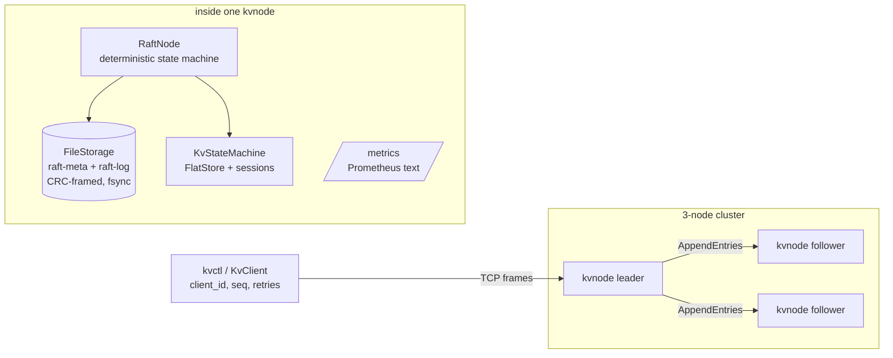

# lldstore

A key-value store in C++20, built in 11 phases. Each phase starts from a measured baseline and is checked with sanitizers. It goes from a single-threaded hash map to a sharded, thread-per-core store, and then to a crash-safe, Raft-replicated 3-node cluster with a linearizability checker.

> **Status (2026-11-16): code complete, mostly unverified.** Every phase builds with `-Werror` in five presets (debug, release, ASan, UBSan, TSan). Only Phases 0 to 2 have been tested and measured. Phases 3 to 11 have **not been run**, apart from one debug run of the Phase 5 table tests. The remaining work is in [`docs/LINUX_RUNBOOK.md`](docs/LINUX_RUNBOOK.md). Results in [`docs/BENCHMARKS.md`](docs/BENCHMARKS.md) are marked either measured or PLANNED; quote only the measured ones.

## Architecture



**Inside one process (Phases 1 to 6):** callers hash each key (FNV-1a + splitmix64) to a shard. Each shard has one worker thread, optionally pinned to a core. That thread alone owns the shard's table: an open-addressing `FlatStore` whose entries come from a per-shard slab allocator. Requests reach the worker through a lock-free MPSC queue, whose links live inside the caller's stack-allocated request. A test proves that, once warm, this path performs zero heap allocations.

**On disk (Phase 7):** a write-ahead log made of CRC-32C-framed records, with group commit (one `fdatasync` for many writers). Snapshots replace the old file atomically (tmp + fsync + rename + directory fsync). Recovery stops at the first torn record.

**Across machines (Phases 8 and 10):** Raft runs as a pure, deterministic state machine. It has elections, log replication, a no-op entry per term and check-quorum, and clients get exactly-once sessions. The same code runs in a seeded simulator, which injects message loss, reordering, partitions and crashes, and checks every run with a Wing and Gong / Lowe linearizability checker.

**Concurrent reads (Phase 9):** epoch-based reclamation, and `RcuMap`, a single-writer map whose readers take no lock.

## Build and try it

```bash
cmake --preset release && cmake --build --preset release -j
scripts/cluster_local.sh start                    # 3 nodes on localhost
build/release/apps/kvctl put hello world
scripts/cluster_local.sh kill "$(scripts/cluster_local.sh leader)"   # crash the leader
build/release/apps/kvctl get hello                # still there
build/release/apps/kvctl bench --mode=open --clients=16 --rate=5000 --seconds=10
curl -s localhost:9101/metrics | grep lldstore_raft
scripts/cluster_local.sh wipe
```

With Docker: `docker compose up -d --build`, then `docker compose run --rm client status`. Prometheus is at http://localhost:9090.

Tests: `ctest --preset debug` (245 tests). Use the `asan`, `ubsan` and `tsan` presets for the sanitizers. Every command is listed in [`COMMANDS.md`](COMMANDS.md).

## Measured results (Phase 2 only so far)

From [`docs/BENCHMARKS.md`](docs/BENCHMARKS.md), with hardware, commit and command given there. These are in-process numbers, with 1M keys and 90% reads.

| Result | Mac (M5, libc++) | Linux (i5-12400F, libstdc++) |
|---|---|---|
| Mutex-protected `unordered_map`, closed loop, 1 → 4 clients | 4.78M → 1.90M ops/s (B-005) | see B-005 (Linux) |
| `shared_mutex` vs `mutex` at 4+ clients | 0.15-0.75x (slower) | 1.24-1.32x (faster) |
| Open loop at 200K ops/s, `MutexStore`, 64 clients | p50 1.6 µs, p99 145 µs (B-006) | see B-006 (Linux) |
| gRPC server, closed loop | ~52K req/s inline, ~40K with the thread pool (B-007) | not measured (gRPC too old) |

The `shared_mutex` result reverses between the two standard libraries. That is the main lesson so far: measure on the machine you care about. Every later phase has a planned measurement with written predictions (B-011 to B-019); none has been run yet.

## Limitations (on purpose; each one is a design record)

- **Raft:**
  - No membership change, log compaction or snapshots: the log grows forever (D-050).
  - No PreVote and no lease reads; every read goes through the log.
- **Durability:**
  - Checkpoints stop the world (D-043).
  - Slab memory is never returned to the OS (D-034).
  - Client sessions are never expired (D-051).
- **Scale:**
  - Thread-per-connection networking (D-053) is fine for a 3-node cluster and tens of clients, not for thousands.
  - The hash routing assumes a fixed shard count (D-012).
- **Authorship:** Phases 3 to 11 were written by an AI assistant at the owner's request. The design records, drills and model answers are written up separately so each decision can be studied and defended (D-059).

## Map of the repository

| Path | What |
|---|---|
| `include/lldstore/` | the library: stores, queues, allocator, WAL, Raft, checker, metrics |
| `src/` | compiled parts (log file, WAL, durable store, Raft, networking, node, client, checker) |
| `apps/` | `kvnode` (server), `kvctl` (client, load generator, history recorder), `lincheck` |
| `tests/` | GoogleTest suites, the Raft simulator (`raft_sim.h`), chaos runs |
| `bench/`, `scripts/` | benchmarks and the scripts that run them; `scripts/reproduce_all.sh` runs everything |
| `deploy/` | Prometheus config; the EC2 deployment (written, not run) |
| `docs/` | `DESIGN.md` (D-001 to D-066), `BENCHMARKS.md`, `PROGRESS.md`, `PHASES.md`, notes and runbook |
